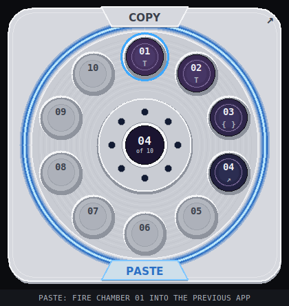
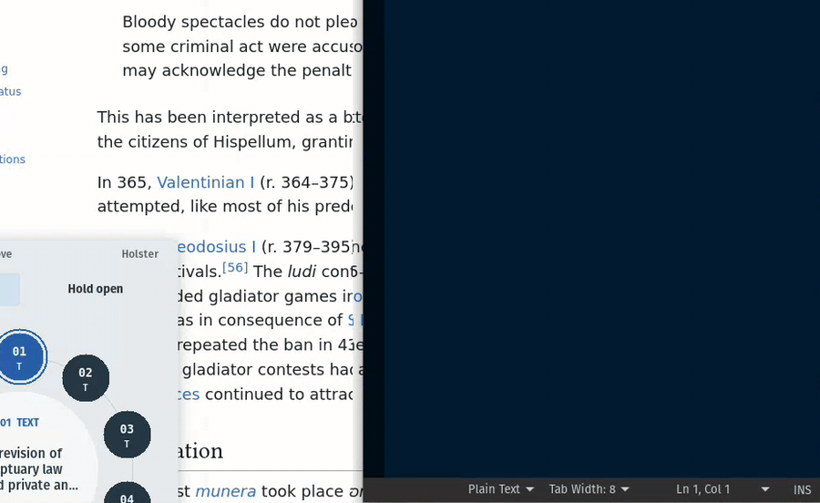

<p align="center">
  
</p>

<h1 align="center">CopyBoard</h1>

<p align="center"><strong>Keep what you copy. Paste what you need.</strong></p>
<p align="center">A local clipboard revolver with 10–16 chambers for fast desktop work.</p>

<p align="center">
  <a href="#try-it">Try it</a> ·
  <a href="#how-it-works">How it works</a> ·
  <a href="docs/USER_GUIDE.md">User guide</a> ·
  <a href="CONTRIBUTING.md">Contribute</a>
</p>

<p align="center">
  
  &nbsp;&nbsp;
  
</p>

CopyBoard helps when one clipboard slot is too small: gathering research, moving text between apps, or reusing links and snippets. New copies rotate into chamber **01**. Pasting a saved chamber does not remove it.

## How it works

1. Copy text in any app. CopyBoard keeps the newest 10–16 clips in numbered chambers.
2. Open **Widget Mode** from the editor. Click a chamber to paste it into your previous app, or press the hub, flick toward a chamber, and release.
3. Use **PIN** to keep the plate visible for repeated pastes. Unpinned, it hides after a paste. Open the editor when you need to edit, combine, eject, or resize clips.

Optional global shortcuts can summon the plate or fire a chamber directly. Shortcut registration requires the `hotkeys` extra and a working keyboard backend; the on-screen controls work without it. [Full controls and configuration](docs/USER_GUIDE.md).

## Try it

**Linux/X11** is the exercised desktop path. No packaged GitHub release is published yet; run current source. On Ubuntu or Pop!_OS:

```bash
sudo apt install python3-venv python3-tk libxfixes3 xdotool xclip
git clone https://github.com/Dennis-J-Carroll/copyboard_app.git
cd copyboard_app
python3 -m venv .venv
source .venv/bin/activate
python -m pip install -e .
copyboard-gui
```

Copy text, open **Widget Mode**, and choose a loaded chamber. The `xdotool` dependency handles focus restoration and automatic paste on X11; `xclip` helps keep clipboard content after CopyBoard exits. Native Wayland sessions can limit automatic paste. macOS and Windows run from source with OS-specific dependencies and permissions; see [platform notes](docs/USER_GUIDE.md).

## Widget development preview



<sub>Filmed on Linux/X11 with text from [Wikipedia's Gladiator article](https://en.wikipedia.org/wiki/Gladiator). This clip shows a local widget build with **Hold open** and a side holster; those controls are still being integrated with current `master`. Current source uses **PIN** for repeated pastes.</sub>

## What is included

| Surface | Purpose |
| --- | --- |
| Quick-paste plate | Flick or click a chamber; pin it for repeated pastes |
| Full editor | Inspect, edit, combine, eject, resize, and clear clips |
| CLI | List, add, copy, clear, and split tagged scenes into chambers |
| Browser and file-manager integrations | Optional ways to capture content into the same board |

CopyBoard runs locally. Text history is stored as **plain JSON** in `~/.config/copyboard/board.json`; it is not encrypted. Copies marked concealed or transient are skipped where the operating system exposes those markers. Avoid storing secrets in the board, and clear it when needed. There is no account or cloud sync.

## Learn more

- [User guide](docs/USER_GUIDE.md): controls, shortcuts, configuration, diagnostics, and platform notes
- [Cross-platform quick-paste plan](docs/CROSS_PLATFORM_QUICK_PASTE.md) and [tagged-scene import](docs/DISASSEMBLY.md)
- [Browser extension](browser_extension/README.md) and [context-menu integration](docs/CONTEXT_MENU_INTEGRATION.md)
- [Contributing](CONTRIBUTING.md), [changelog](CHANGELOG.md), and [MIT license](LICENSE)

CopyBoard is a work in progress. Try it and [report what slows you down](https://github.com/Dennis-J-Carroll/copyboard_app/issues/new/choose).
